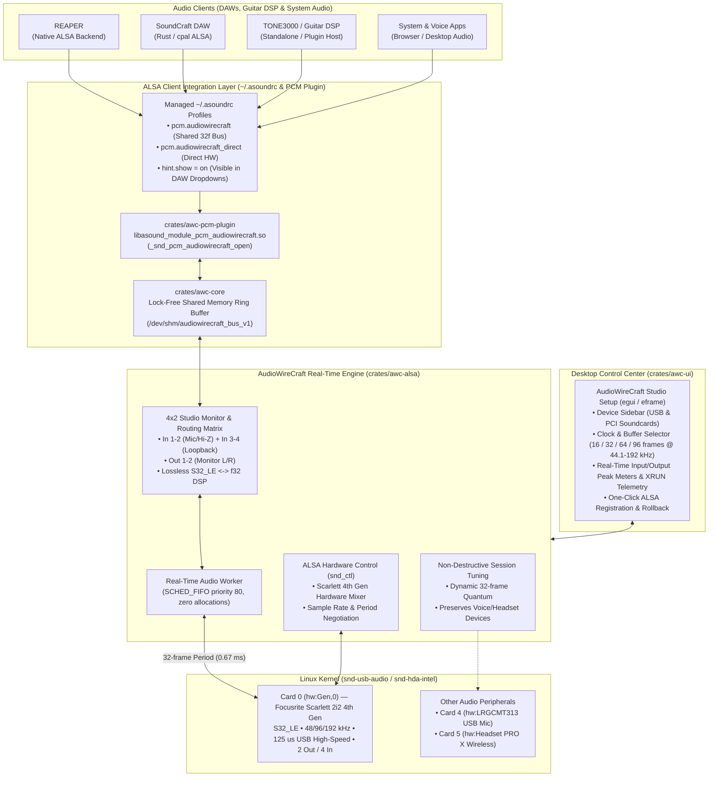
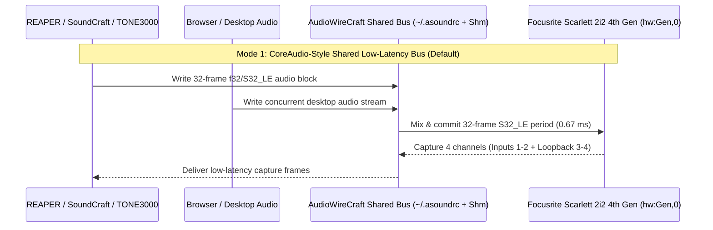

# WireAudio Architecture Specification

## 1. Problem Statement & Motivation

On macOS (`CoreAudio`) and Windows (multi-client ASIO drivers such as Focusrite USB ASIO + WDM), a studio audio interface like the **Focusrite Scarlett 2i2 4th Gen** works as a unified general-purpose device:

1. **Plug-and-Play Visibility**: Connecting the interface immediately exposes all physical inputs (`Mic/Line/Hi-Z 1–2`), internal loopback channels (`Loopback 3–4`), and monitor outputs (`Monitor L/R`) in a single window (**Audio MIDI Setup**).
2. **Ultra-Low Latency**: Guitar amp modelers (**TONE3000** / NAM) and DAWs (**REAPER**, **[SoundCraft](https://github.com/storytold/soundcraft)**) run cleanly at **32 frames** (`0.67 ms` one-way / `~2.0 ms` round-trip at `48 kHz`).
3. **Simultaneous Multi-Client Sharing**: Opening REAPER at 32 frames does **not** mute or break web browsers, YouTube, or voice communication apps.

On Linux, by contrast, standard desktop audio stacks often default USB interfaces to large safety buffers (e.g., `period_size = 256`, `buffer_size = 768` = `16 ms` buffer latency) or force users into fragile JACK patchbays where exclusive `hw:` capture breaks desktop/voice audio.

**AudioWireCraft** solves this directly on top of `alsa-lib` (`libasound`) in Rust.

---

## 2. High-Level System Architecture

---

## 3. Target Hardware Profile: Focusrite Scarlett 2i2 4th Gen

Inspection of `/proc/asound/card0/stream0` on Linux shows the exact hardware capabilities of the **Focusrite Scarlett 2i2 4th Gen** (`hw:Gen,0`):

| Parameter | Playback (`Endpoint 0x01 OUT`) | Capture (`Endpoint 0x81 IN`) |
| :--- | :--- | :--- |
| **Sample Format** | `S32_LE` (24-bit in 32-bit container) | `S32_LE` (24-bit in 32-bit container) |
| **Channels** | `2` (`Monitor FL`, `Monitor FR`) | `4` (`Input 1`, `Input 2`, `Loopback L`, `Loopback R`) |
| **Sample Rates** | `44100, 48000, 88200, 96000, 176400, 192000 Hz` | `44100, 48000, 88200, 96000, 176400, 192000 Hz` |
| **USB Data Interval** | `125 us` (8 microframes / ms) | `125 us` (8 microframes / ms) |

### Why 32 Frames Works Reliably on USB High-Speed

Because the USB endpoint operates at a `125 us` packet interval (`8000` packets/second), at `48000 Hz` each USB microframe carries exactly `6` samples per channel. A `32-frame` period corresponds to `0.667 ms` (`~5.3` microframes), and with `3` periods (`96` frames total buffer):

- **One-way period latency**: `32 / 48000 = 0.67 ms`
- **Output DMA buffer latency**: `96 / 48000 = 2.00 ms`
- **At 96 kHz (32 frames)**: `0.33 ms` one-way / `1.00 ms` output buffer

---

## 4. Multi-Client Shared Bus vs. Exclusive Direct Mode

AudioWireCraft supports three selectable routing modes in the UI without requiring package removal:

1. **`SharedLowLatencyBus` (Default — CoreAudio Style)**:
   - Configures shared `dmix`/`dsnoop` and POSIX shared-memory (`ShmAudioBusHeader` in `/dev/shm/audiowirecraft_bus_v1`) locked to `period_size = 32` frames and `S32_LE`.
   - Allows **REAPER**, **SoundCraft**, **TONE3000**, and system/browser audio to share the Scarlett 2i2 4th Gen simultaneously.
2. **`SystemSharedTuned`**:
   - Keeps the active desktop session intact (preserving USB microphones and wireless headsets used for voice calls) while dynamically forcing the runtime audio quantum to `32` frames (`pw-metadata clock.force-quantum 32`).
3. **`ExclusiveDirectHw`**:
   - Maps `pcm.audiowirecraft_direct` straight to `hw:Gen,0` for zero-intermediary DMA access when dedicated single-app recording is desired.

---

## 5. Real-Time Safety Guarantees

To prevent audio dropouts (`XRUN`s) at 32 frames, the real-time audio path in `awc-core` and `awc-alsa` adheres to strict real-time invariants:

- **Zero Heap Allocations in the Audio Callback**: All sample buffers (`play_buf`, `cap_buf`, and `ShmAudioBusHeader`) are pre-allocated before entering the audio loop.
- **Wait-Free Atomic Telemetry**: Peak meters (`input_peaks_bits`, `output_peaks_bits`) and XRUN counters use `AtomicU32` / `AtomicU64` with `Ordering::Relaxed` so the 60 FPS `egui` UI never blocks the audio thread.
- **`SCHED_FIFO` Thread Priority**: The audio thread elevates itself to `SCHED_FIFO` (priority `80`) via `pthread_setschedparam`.
